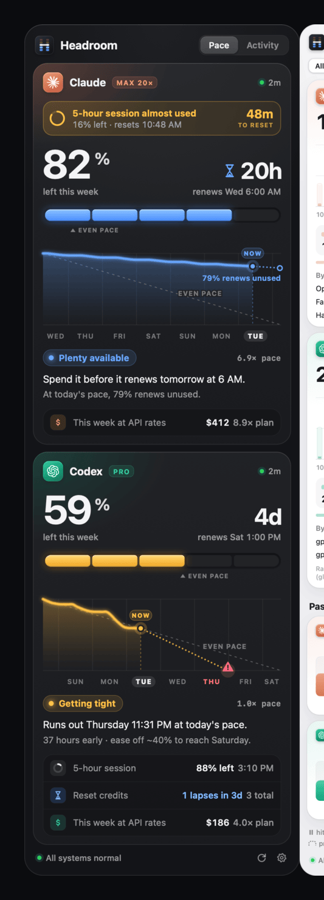
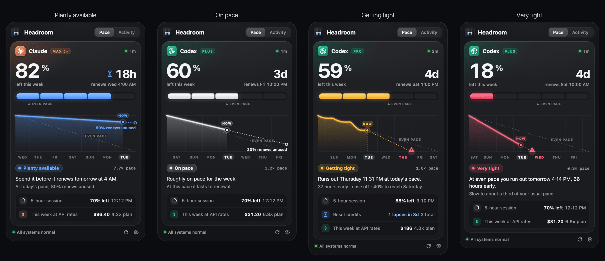
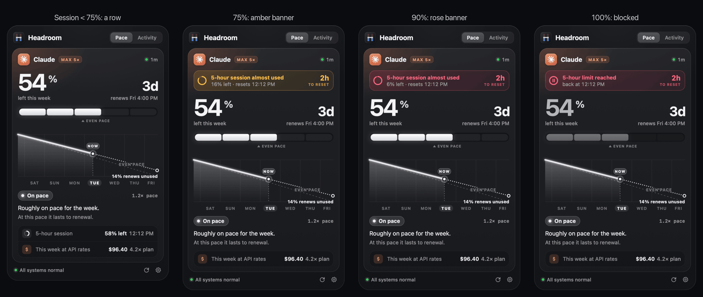
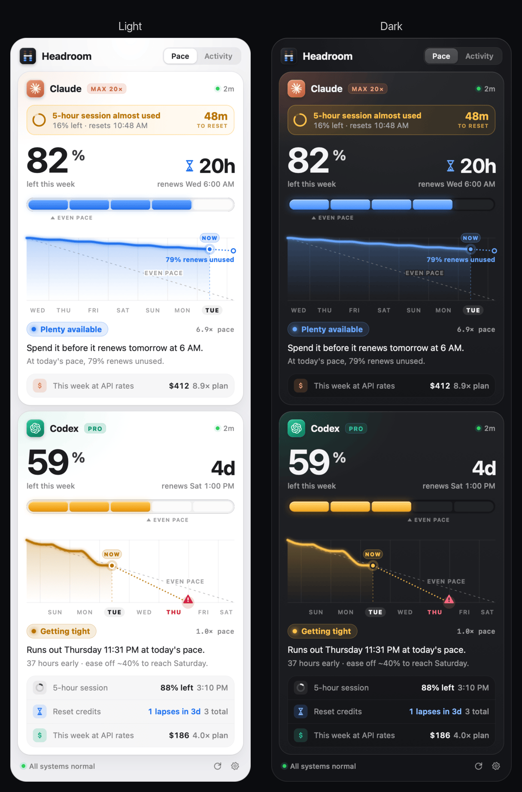
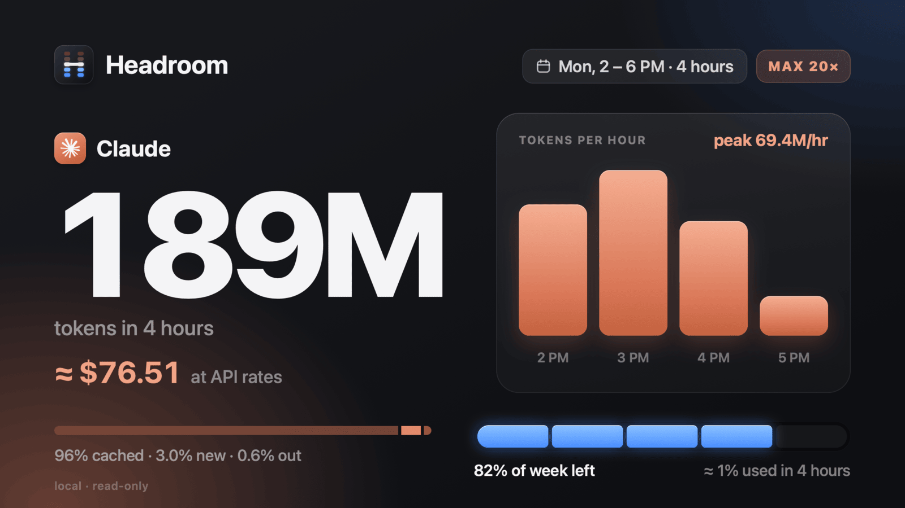

<p align="center">
  
</p>

<h1 align="center">Headroom</h1>

<p align="center">
  <b>How much of your weekly Claude and Codex allowance is left, against the time left until it renews.</b><br>
  A native macOS menu-bar app and a <code>headroom</code> command. Local and read-only.
</p>

<p align="center">
  <a href="https://github.com/0xgeorgemathew/headroom/releases"></a>
  
  
  
  
</p>

<p align="center">
  
</p>

> **Beta.** This is the first public beta. It's built and tested on one Mac; please
> [open an issue](https://github.com/0xgeorgemathew/headroom/issues) if something looks wrong.

## Install

```sh
curl -fsSL https://raw.githubusercontent.com/0xgeorgemathew/headroom/main/install.sh | bash
```

The script downloads the latest release, checks its SHA-256, removes the download quarantine
(the app is signed but not notarized), installs `Headroom.app` to `/Applications`, links the
`headroom` command into `~/.local/bin` with its man page, and opens the app. Then turn on
**Launch at login** in Settings.

Requirements: an Apple silicon Mac on **macOS 26** or later, and Claude Code and/or the Codex CLI
signed in with a subscription (Claude Pro/Max/Team, ChatGPT plan).

<details>
<summary>Other ways to install, update or remove</summary>

- **A specific version:** `curl -fsSL …/install.sh | bash -s -- --version v0.1.0-beta.1`
- **Update:** run the install command again.
- **Manual:** download `Headroom-<version>.zip` from [Releases](https://github.com/0xgeorgemathew/headroom/releases),
  unzip, move `Headroom.app` to `/Applications`, then run `xattr -dr com.apple.quarantine /Applications/Headroom.app`.
- **Uninstall:** `curl -fsSL …/install.sh | bash -s -- --uninstall` (add `--purge` to also delete
  `~/Library/Application Support/Headroom`).
- **From source:** see [Build](#build).

</details>

## What it shows

### Pace: will this week's allowance last?

Each provider gets a card with the allowance left, the time to renewal, a five-cell meter with an
*even pace* caret, and a glide path of the week so far with a dotted projection. The verdict is a
single number, **S = allowance left ÷ time left**: *you can run at S× even pace until the reset
and land exactly at zero.*

<p align="center"></p>

| State | Rule | Means |
|---|---|---|
| **Plenty available** (azure) | S ≥ 2 and ≥ 20% left | Allowance will go unused; the hourglass appears when renewal is under 48 h |
| **On pace** (pearl) | 1 ≤ S < 2 | Lasts to renewal at this pace |
| **Getting tight** (amber) | 0.75 ≤ S < 1, or the last 24 h burn runs out early | Ease off a little |
| **Very tight** (rose) | S < 0.75 | You'll run out early at even pace |

The last-24-hour projection can raise the state but never lower it, and state changes need a ±0.05
crossing and 10 minutes of dwell, so the color doesn't flicker.

### The 5-hour session warns before it bites

<p align="center"></p>

Below 75% used the session is a row. From 75% it becomes an amber banner with a countdown, rose
from 90%, and *5-hour limit reached* at 100%. The menu bar shows the countdown too.

### Model caps, early resets and reset credits

<p align="center"></p>

### It says exactly what's wrong, and keeps the last good reading

<p align="center"></p>

### Activity: tokens and what they would cost at API rates

<p align="center"></p>

Hourly bars from your local Claude Code and Codex logs (24 hours, 7 days or 30 days), with cached
reads, new input and output stacked. Drag across the bars to select a span (double-click to select
from a bar to now) and see its tokens, its cost at API rates, and a breakdown **by model, project
or token class**. Prices are applied per request from a bundled rate card (long-context, fast-mode
and cache-write tiers included); unknown models are counted and labelled *unpriced*. Override or
add prices in `~/Library/Application Support/Headroom/pricing.override.json`.

**Past weeks** shows each renewal week against a track to 100%, the weeks that ran out (and how many
hours early), 5-hour limit hits, early resets and plan changes. Click a week to see its glide path.

### The menu bar

<p align="center"></p>

Brand mark plus a five-cell meter per provider, an hourglass when *Plenty* is about to renew, a
session timer while the 5-hour session is at 75% or more, and pause/fault overlays. Beside the
notch, choose **Most urgent** in Settings to show just the provider that needs attention.

### Light and dark

<p align="center"></p>

### Share your burn

Right-click any card: **Copy Card** (1200×675 PNG), **Copy Snapshot** (both providers) or
**Copy as Text**. Shares never include project names, paths or history curves; the share model has
no fields for them.

<p align="center"></p>

```text
Headroom · Mon, 2 – 6 PM · 4 hours
189M Claude tokens · ≈ $76.51 at API rates
▇█▆▃
96% cached · 3.0% new · 0.6% out
ate 1% of my week
🟦🟦🟦🟦⬛ 82% of week left
```

## The `headroom` command

```text
$ headroom
Claude  🟦🟦🟦🟦⬛   82% · renews in 20h ⏳
  ↳ plenty · 80% renews unused at this pace
  ↳ ⚠ 5-hour session 16% left · resets 12:30
Codex   🟨🟨🟨⬛⬛   59% · renews in 4d
  ↳ tight · runs out Fri 4 PM, 21h early
  ↳ ⏳ 1 reset credit lapses in 3d
```

| Command | What it does |
|---|---|
| `headroom` | The summary above |
| `headroom --json` | Every number (windows, S, state, caps, credits, faults, 24 h activity, costs), schema 1 |
| `headroom --refresh` | Asks the app for fresh limits, waits for them, prints |
| `headroom statusline [--format claude\|tmux\|sketchybar\|plain]` | One short line; honors `NO_COLOR` |
| `headroom wait [--provider claude\|codex\|any] [--timeout 6h] [--json]` | Blocks until the 5-hour session, weekly limit or outage clears. Exit 0 = capacity back, 2 = timeout, 3 = no data |

The CLI only reads the snapshot the app writes (`~/Library/Application Support/Headroom/snapshot.json`).
It never touches credentials or the network, and it runs in about 8 ms. `man headroom` has the details.

**Claude Code status line** (`~/.claude/settings.json`):

```json
{ "statusLine": { "type": "command", "command": "~/.local/bin/headroom statusline" } }
```

**Run a long job when the session frees up:**

```sh
headroom wait --provider claude && claude -p "continue the refactor"
```

## Privacy and safety

Headroom is read-only toward both providers, and the guarantees are enforced in code and tests:

- **Claude:** `GET https://api.anthropic.com/api/oauth/usage` with Claude Code's own OAuth token,
  read through `/usr/bin/security find-generic-password` and kept in memory only. If the token has
  expired, Headroom runs exactly `claude -p /usage --no-session-persistence --strict-mcp-config`
  with hooks disabled (no tokens used), at most every 30 min while the popover is open or every 2 h
  otherwise, so Claude Code refreshes its own credentials.
- **Codex:** fresh `rate_limits` from your session logs first; otherwise the running Codex app-server
  daemon, or an isolated `codex app-server` (plugins, apps, hooks and MCP servers turned off) that
  is closed after the read. Only `initialize`, `account/read` and `account/rateLimits/read` can be
  sent: the method set is a three-case enum, and a test checks it.
- **Never:** sends a prompt, starts a session, redeems a reset credit, or refreshes, rewrites or
  stores credentials.
- **Network:** only `api.anthropic.com` and, if enabled, `status.claude.com` and `status.openai.com`.
  A URLSession delegate rejects every other host. No analytics, crash reporter or updater.
- **Local logs:** `~/.claude/projects` and `~/.codex/sessions` are tailed read-only. No prompt or
  response text is kept, only token counts per request.

## Efficient by design

Measured on an M3 Pro with real logs:

| | Budget | Measured |
|---|---|---|
| Memory while idle | ≤ 25 MB | 16–17 MB |
| Memory with the popover open | ≤ 45 MB | 29–31 MB |
| CPU while idle | ≈ 0% | 0.0%, 0.4 wakeups/min |
| First scan of 35 days of logs (3.3 GB) | ≤ 3 s | 0.9–1.7 s |
| Incremental ingest | ≤ 5 ms per MB | 1.7 ms per MB |
| `headroom statusline` | ≤ 10 ms | 7–8 ms |
| App binary | ≤ 5 MB | 2.3 MB |

It's Swift 6, AppKit and Core Graphics with no third-party dependencies, and it doesn't use SwiftUI.
Log files are tailed by appended bytes (FSEvents, mmap, memchr), and Codex's compressed `.jsonl.zst`
rollouts are read with a built-in zstd decoder. Polling is adaptive and pauses during sleep and
screen lock.

## Build

Needs Xcode 27 (Swift 6.4) and an Apple Development signing identity.

```sh
make test          # 237 tests: pacing, pricing, ingestion, providers, safety, CLI
make install       # build, sign, install to /Applications, link the CLI, launch
make screenshots   # render every UI state from fixtures into media/ (needs ImageMagick)
make release       # dist/Headroom-<version>.zip and its SHA-256
```

Every screenshot in this README is rendered from fixtures by the app itself
(`HeadroomApp --render <scenario|all> --out <dir>`), so no real account data appears in it.

| Module | Contents |
|---|---|
| `HeadroomKit` | Models, pacing engine, pricing, snapshot schema, formatters (Foundation only) |
| `HeadroomCore` | Log ingestion, zstd, provider clients, credentials, scheduler, stores |
| `HeadroomApp` | Menu bar, popover, settings, share renderer |
| `headroom` | The CLI (links `HeadroomKit` only) |

## Notes

- Built for standard setups: Claude Code signed in with a subscription, and Codex signed in with
  ChatGPT using the built-in `openai` provider. Usage from other providers still counts toward
  Activity and cost, but not toward limits.
- Claude Team seats without an all-models weekly limit show the tightest model-scoped weekly cap
  (for example *left this week · Fable*).
- The app is signed with an Apple Development certificate and isn't notarized, which is why the
  installer removes the quarantine flag.
- Claude and the Claude mark are trademarks of Anthropic; OpenAI and Codex are trademarks of OpenAI.
  The marks come from [Simple Icons](https://simpleicons.org) and are used only to label each
  provider. Headroom isn't affiliated with either company.
