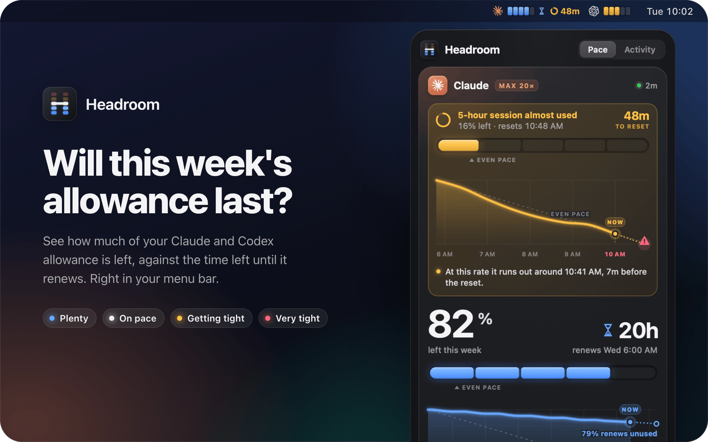
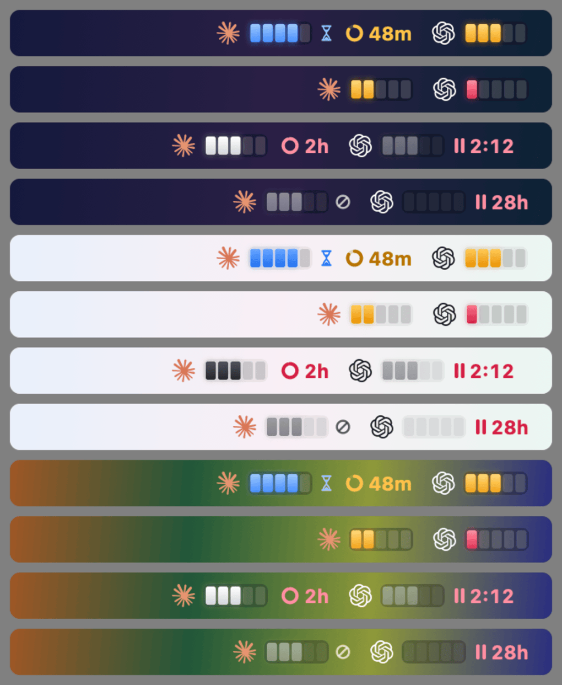
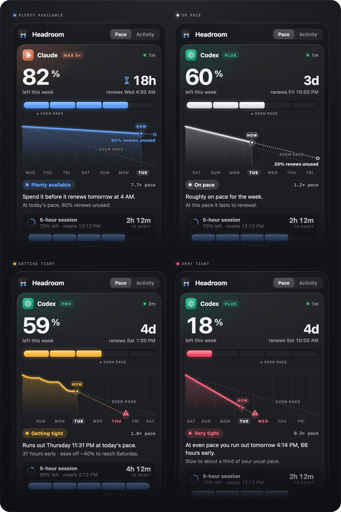
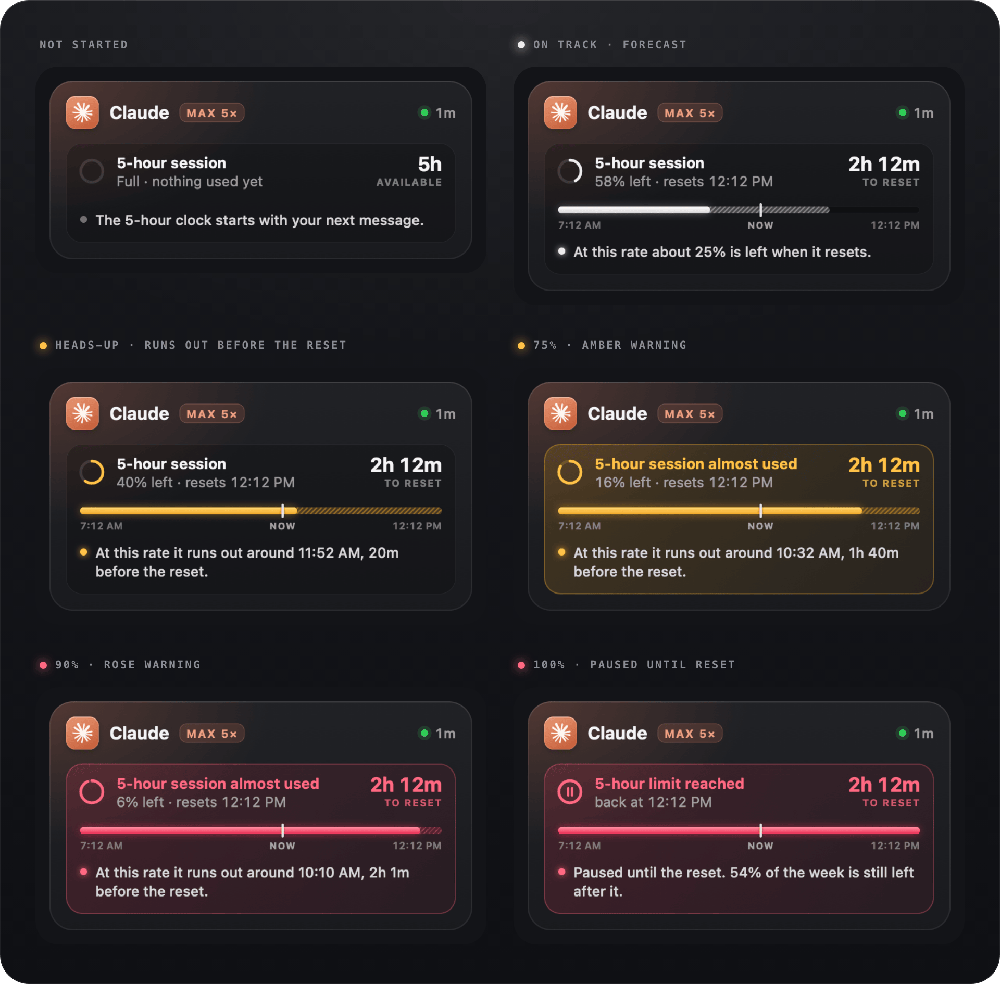
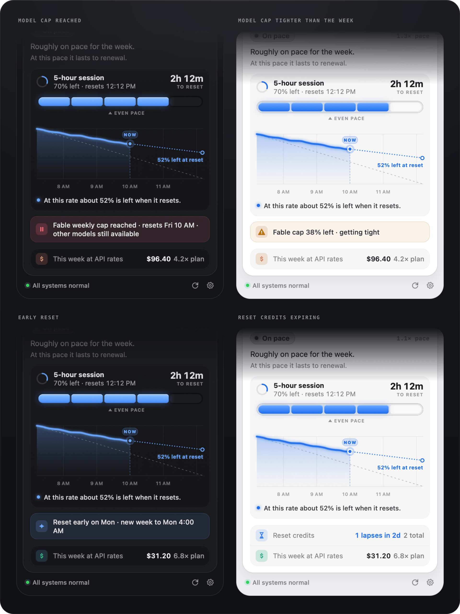
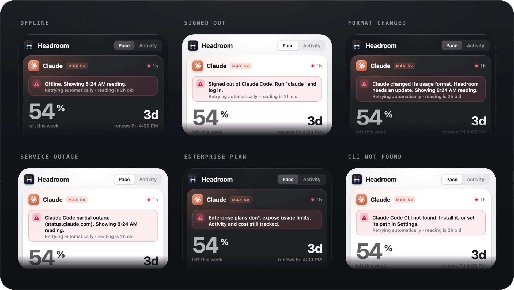
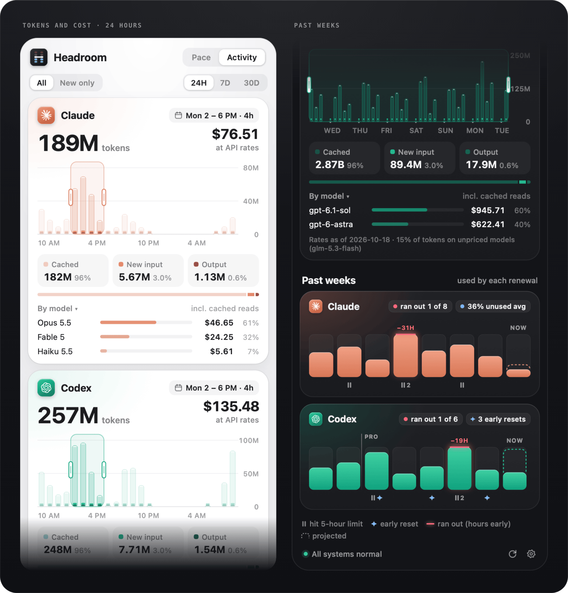
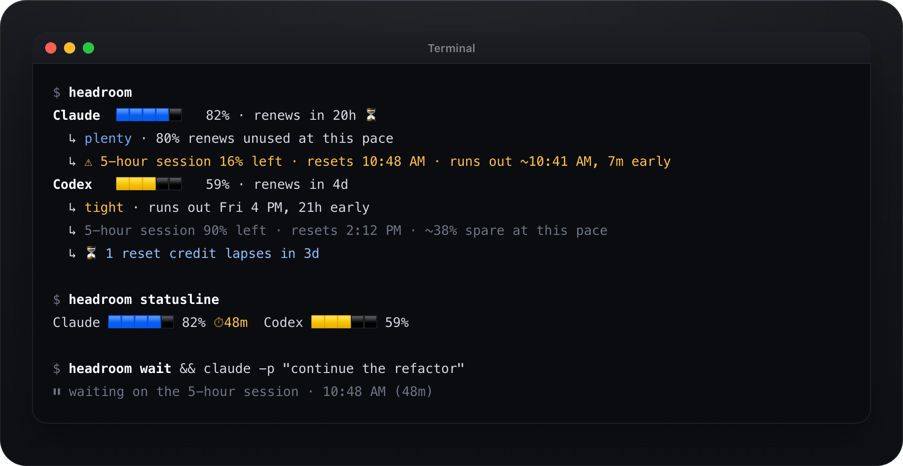

<p align="center">
  <picture>
    <source media="(prefers-color-scheme: dark)" srcset="media/hero-dark.png">
    <source media="(prefers-color-scheme: light)" srcset="media/hero-light.png">
    
  </picture>
</p>

<p align="center">
  <a href="https://github.com/0xgeorgemathew/headroom/releases"></a>
  
  
</p>

<p align="center">
  Headroom sits in your menu bar and answers one question for your Claude and Codex plans:<br>
  <b>do you have room to spare this week, are you on pace, or should you slow down?</b>
</p>

<br>

## Install

Paste this into Terminal:

```sh
curl -fsSL https://raw.githubusercontent.com/0xgeorgemathew/headroom/main/install.sh | bash
```

Headroom appears in your menu bar a few seconds later. Open its Settings to turn on **Launch at login**.

You'll need a Mac with Apple silicon on macOS 15 or later, and Claude Code or Codex signed in to your subscription.

<br>

## Your week, at a glance



Each provider gets five cells in your menu bar. **Blue** means you have room to spare, **white** means you're on pace, **amber** and **rose** mean slow down. An hourglass shows when unused allowance is about to renew, and a countdown appears when your 5-hour session is nearly used up.

## Pace, not just a percentage



82% left sounds great until you notice it renews tomorrow. Headroom compares what's left with the time left, draws your week so far, and tells you in one sentence whether to use more, keep going, or ease off, and roughly when you'd run out.

## A warning before the 5-hour limit



Your 5-hour session stays a quiet line until it matters. At 75% it turns into an amber warning with a countdown, at 90% it turns rose, and when you hit the limit it tells you exactly when you're back.

## Caps, early resets and expiring credits



If a single model like Fable has its own weekly cap, Headroom tells you when that cap is the one to watch. It also notices when your week resets early, and highlights reset credits that are about to expire so you don't lose them.

## A plain answer when something's off



Offline, signed out, a service outage: Headroom says what happened and how to fix it, keeps showing your last reading with its age, and tries again on its own.

## What your usage is worth



The Activity tab shows your tokens hour by hour for the last day, week or month, and what they would have cost at API prices. Drag across the bars to price any stretch of time, and break it down by model or project. **Past weeks** shows how much of each week you used, which weeks ran out early, and how much renewed unused.

## Share your burn


Right-click any card to copy a share image or a text version. Shares never include project names or your history.

## Also in your terminal



Type `headroom` for the same summary, add a one-line status to your prompt or editor, or have a long job wait until your session frees up. `man headroom` has the details.

<br>

## Private by design

- Headroom only **reads**. It never sends a prompt, never uses one of your reset credits, and never changes your sign-in.
- Your token counts come from files already on your Mac. Nothing you type is stored, and nothing is uploaded.
- The only places it connects to are Anthropic's usage page and, if you leave it on, the Claude and OpenAI status pages. No analytics, ever.
- It's light: about 17 MB of memory and no CPU while it waits.

## Update or remove

Run the install command again to update. To remove Headroom:

```sh
curl -fsSL https://raw.githubusercontent.com/0xgeorgemathew/headroom/main/install.sh | bash -s -- --uninstall
```

## License

Public domain under [The Unlicense](LICENSE). Use it, change it, sell it; no permission needed.

<br>

<p align="center"><sub>Claude is a trademark of Anthropic. OpenAI and Codex are trademarks of OpenAI. Headroom is an independent project and isn't affiliated with either.</sub></p>
